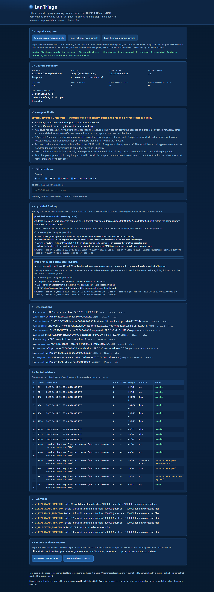

# LanTriage

<!-- prototype-status:start -->
> **Experimental concept prototype — idea exploration only.**
> This is a work-in-progress concept/demo, not a finished product or production-ready release. Implemented features and local tests demonstrate the prototype only; they do not establish real-world reliability, complete functionality, or hardware compatibility. Features may change or remain unfinished.

See [PROTOTYPE.md](PROTOTYPE.md) for publication status and verification limits.
<!-- prototype-status:end -->

**Offline, bounded pcap / pcapng evidence viewer for DHCP, ARP and mDNS observations.**
Open `index.html` from disk — no server, no build step, no installation, no CDN, no telemetry.



*(Screenshot: the embedded fictional sample — self-authored synthetic bytes, `aa:00:…` MACs and `192.0.2.x` addresses. No real capture appears anywhere in this repository.)*

## What it is — and what it is not

LanTriage reads a capture file you choose and turns it into **evidence about what the
file contains**: decoded DHCP/ARP/mDNS observations, qualified candidate findings,
and explicit counts of everything it could *not* decode.

* **It is** a small, auditable, dependency-free analyzer with a documented subset
  (`docs/formats.md`), visible non-decoded/rejected counts, evidence references
  (packet index, byte offset, timestamp, interface, VLAN) for every observation,
  and reports that are redacted by default.
* **It is not** a Wireshark replacement, and it is **not** a network-health
  diagnosis. A capture only contains traffic that reached the capture point;
  switched networks and other VLANs are invisible unless mirrored. Findings are
  candidates with counterexamples attached, never proof.

## Run it

1. Double-click `index.html` (any modern browser; verified with Chrome on Windows 11 ARM64).
2. Click **Choose .pcap / .pcapng file**, or load one of the two embedded **fictional samples**.
3. Filter, inspect the packet evidence table, then export a **JSON** or **standalone HTML** report.

There is nothing to install and nothing to start. The page makes no data or API
requests: imported data stays local to the page, is never uploaded, and is not
persisted anywhere (no cookies, no storage APIs, no service worker).

## Implemented prototype subset

* **Classic pcap** — little/big endian, microsecond and nanosecond magic; header,
  record lengths, snaplen and timestamp-fraction validation.
* **pcapng** — Section Header, Interface Description and Enhanced Packet blocks,
  plus Simple Packet (snapshot-length prefixes are decodable but limit coverage: truncated:true, coverage limited); multiple sections with per-section byte order and interface
  ids; EPB timestamps read as Timestamp (High) then Timestamp (Low), each in the
  section's byte order; `if_tsresol` recorded exactly as declared (10^-n with n<=9 exact when the scaled seconds fit and display; large ticks are not pre-rejected at 2^53, out-of-range is seconds:null/exact:false; finer/binary resolutions marked approximate) and `if_tsoffset`;
  unknown blocks skipped by length and counted, and options this subset does not
  interpret counted and warned by numeric code/offset only.
* **Protocols** — Ethernet II, bounded 802.1Q/802.1ad VLAN (≤ 2 tags), ARP
  (Ethernet/IPv4; probes and announcements distinguished), IPv4/UDP DHCP (67/68,
  RFC 2131/2132 options incl. message type, hostname, requested IP, server id,
  lease, overload detection) and mDNS (5353, QU bit, cache-flush bit, A/AAAA/PTR/
  SRV/TXT answers, RFC 1035 name compression with cycle/range/length checks).
* **Everything else is counted, never silently healthy** — IPv6, non-UDP IP,
  fragments, deeper VLAN nesting, LLC, non-Ethernet link types, RARP, malformed
  DNS/DHCP and rejected records all appear as visible "not decoded / rejected"
  counts and coverage reasons in the UI and in both report formats.

Exact rules, validation codes and citations: **`docs/formats.md`**.

## Findings (qualified by design)

Computed strictly per capture context (section + interface + VLAN), so claims are
never merged across contexts:

| Finding | Meaning |
|---|---|
| `possible-ip-mac-conflict` | one address claimed by ≥ 2 hardware addresses (probes excluded) |
| `probe-for-in-use-address` | an ARP probe for an address observed in use |
| `possible-duplicate-dhcp-assignment` | one `yiaddr` offered/ACKed to ≥ 2 client hardware addresses |
| `arp-address-transition` *(info)* | one hardware address seen with several addresses over time |

Every finding ships with its qualifier, its benign counterexamples (virtual-router
MACs, adapter changes, retransmissions, context separation) and bounded evidence
references. The counterexamples are themselves under test (see `docs/verification.md`).

## Reports and redaction

* **Default: redacted.** MAC addresses, IPv4 addresses, host/service names,
  interface names and file names become per-report ordinals (`mac-01`, `ip-01`,
  `name-01`, `iface-01`, `file-01`, first-seen order).
* **Opt-in:** a checkbox includes the raw identifiers in the export.
* **Raw packet payloads are never included in any report**, redacted or not — the
  model drops packet bytes after decoding, so there is nothing to leak.
* The HTML report is standalone and **script-free** (no `<script>`, no remote
  references); the JSON report is plain JSON. Both embed the coverage summary,
  warnings and the capture-visibility limitations.

## Limits (all enforced and visible when hit)

32 MiB per file · 20 000 packets · 50 000 pcapng blocks · 2 000 observations ·
200 warnings · 255-byte stored strings · 8 evidence refs per finding ·
64 DNS pointer hops · 64 DNS records per message · 2 VLAN tags. Full table and
behaviour: `docs/formats.md` §3.

## Tests

Zero-dependency unit suite plus a real-Chrome browser suite (the browser suite
uses a copy of the parent-verified CDP helper; no Playwright, no installation):

```sh
node --test tests/core.test.cjs   # 91 tests, 91 pass, exit 0  (fix-round-2 run; baseline fix-round-1 was 83/83)
node tests/browser.cjs            # 6 scenarios, 6 pass, exit 0 (real Chrome, real downloads)
node tests/fixtures.cjs --write   # regenerate the synthetic fixtures + manifest
```

Browser artifacts default to `tests/evidence/` relative to this folder. Set
`LANTRIAGE_EVIDENCE` to redirect a run without overwriting preserved evidence.

The browser suite imports real fixture files, downloads real reports and parses
the downloaded bytes, opens the downloaded HTML report back in Chrome, exercises
filters, a failed import, racing imports, keyboard focus/activation, 320/390px
layouts with longest-legal-string values, and the conforming pcapng file's
corrected timestamp labels, option coverage and both JSON/HTML downloads. It
fails on any page error, console error or HTTP(S) request. Measured results,
RED→GREEN logs, the frozen parent gates (4/4 and 10/10) and the defects the
tests caught: **`docs/verification.md`**.

## How this compares to Wireshark (bounded)

Wireshark's own User's Guide describes it as a network packet analyzer that
"presents captured packet data in as much detail as possible", with live capture
and dissectors for a very large protocol set. LanTriage deliberately does none of
that: it is an offline, bounded evidence viewer for a documented pcap/pcapng
subset, whose distinguishing properties are visible skip/rejection accounting,
context-scoped qualified findings with counterexamples, and redacted-by-default
reports. Use Wireshark when you need live capture or full protocol depth; use
LanTriage when you want a small auditable tool with an explicitly bounded claim.

## Repository layout

```
index.html  style.css  core.js (pure logic)  app.js (UI)   ← open index.html
fixtures/   self-authored synthetic pcap/pcapng bytes + manifest (documented offsets)
tests/      core.test.cjs (node:test) · browser.cjs (real Chrome) · fixtures.cjs · cdp-browser.cjs
docs/       formats.md (exact subset + citations) · verification.md (measured results)
```

## Status & license

Bounded first release, built and verified locally on 2026-10-11. MIT (`LICENSE`).
The samples, fixtures and screenshots in this repository are fictional synthetic
data, never real captures.
